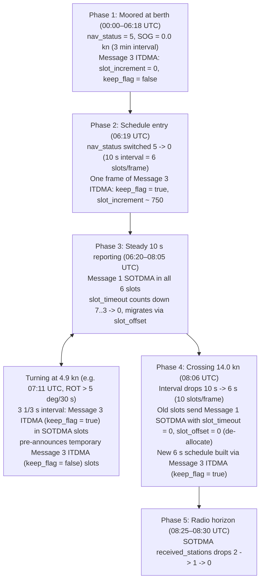

# 17. Deep dive into the communication state

> **What you will learn**
>
> * How the VHF Data Link (VDL) divides every UTC minute into **2 250 time slots** (`26.667 ms` each) on two parallel channels (AIS 1 / channel A and AIS 2 / channel B), and which **eight AIS message types** (`1`, `2`, `3`, `4`, `9`, `11`, `18`, and `26`) carry a 19- or 20-bit communication state at the end of their payload [M.1371-5]
> * Every bit of the **SOTDMA** (`slot_timeout` `0..7` and its four rotating 14-bit sub-messages) and **ITDMA** (`slot_increment`, `slots_raw` with the `+8192` extension, and `keep_flag`) structures, and how the five access schemes (**SOTDMA**, **ITDMA**, **RATDMA**, **FATDMA**, and **CSTDMA**) fit together [M.1371-5]
> * Why random initial slot time-outs drawn from `[TMO_MIN, TMO_MAX] = [3, 7]` produce an unmistakable **`100 / 100 / 100 / 100 / 80 / 60 / 40 / 20 %` staircase** across a day of Message 1 traffic
> * How a vessel uses **ITDMA (`keep_flag = true`)** to enter the data-link schedule when leaving berth, how it interleaves temporary **ITDMA (`keep_flag = false`)** slots while turning, and how it de-allocates old **SOTDMA (`slot_offset = 0`)** slots when crossing the 14-knot reporting threshold
> * How to combine **`slot_number`** (`slot_timeout ∈ {2, 4, 6}`) with **`utc_hour` / `utc_minute`** (`slot_timeout = 1`) to recover exact UTC arrival times and measure a shore logger's clock offset and crystal drift — even when the logger has no GPS or `T` arrival timestamp and is off by nearly a full minute

---

## 17.1 Where this fits

Every chapter that decoded a position or base-station report has ended at the same 19-bit trailer: `comm_state`. In Chapter 3 we wrote `decode_sotdma` and `decode_itdma` to unpack those 19 bits into JSON; in Chapters 6, 10, 14, and 16 we saw the same two functions reappear at the tail of Messages 4, 11, 9, 18, and 26. Until now we treated that sub-object as bookkeeping for the radio and moved on to latitude, longitude, and course over ground.

To the VHF Data Link (VDL), the priorities are reversed: latitude and longitude are opaque payload, while the communication state is the distributed coordination protocol that keeps dozens of ships within radio range from talking over one another on a pair of shared 9 600 bit/s FM channels (`161.975 MHz` AIS 1 / channel A and `162.025 MHz` AIS 2 / channel B) with no central controller required [M.1371-5].

Time on each channel is divided into 60-second **frames** aligned to the start of the UTC minute. Each frame is subdivided into **2 250 slots** numbered `0` through `2249`, so one slot lasts:

$$\frac{60\text{ s}}{2\,250} = \frac{4}{150}\text{ s} = 26.\overline{6}\text{ ms} \quad (256\text{ bits at }9\,600\text{ bit/s})$$

Every scheduled transmission must both fit inside its slot(s) and announce inside its own payload what slots its transmitter intends to use next, so that every other receiver within range can update its internal **slot map** before choosing slots of its own [M.1371-5].

Eight of the 27 AIS messages carry a communication state:

| Message | Name | Chapter | Bit range | Size | Selector bit? | Scheme(s) |
|---|---|---:|---|---:|---|---|
| **1, 2** | Scheduled Class A position report | 3 | `149..167` | 19 | no | Always **SOTDMA** [M.1371-5 Annex 8 Table 48] |
| **3** | Special / interrogated / rate-change Class A position report | 3 | `149..167` | 19 | no | Always **ITDMA** [M.1371-5 Annex 8 Table 49] |
| **4, 11** | Base station report / UTC and date response | 6 | `149..167` | 19 | no | Always **SOTDMA** [M.1371-5 Annex 8 Table 51] |
| **9** | Standard SAR aircraft position report | 10 | `148..167` | 20 | bit `148` (`0` = SOTDMA, `1` = ITDMA) | **SOTDMA** or **ITDMA** [M.1371-5 Annex 8 Table 59] |
| **18** | Standard Class B position report | 14 | `148..167` | 20 | bit `148` (`0` = SOTDMA, `1` = ITDMA) | Class B **SO** uses SOTDMA/ITDMA; Class B **CS** sets bit `148 = 1` and fills `149..167` with the constant `1100000000000000110` [M.1371-5 Annex 8 Table 70] |
| **26** | Multiple slot binary message with communications state | 16 | `len - 20 .. len - 1` | 20 | `len - 20` (`0` = SOTDMA, `1` = ITDMA) | **SOTDMA** or **ITDMA** at the *trailing* 20 bits after variable-length data [M.1371-5 Annex 8 Table 82] |

Why `sample-data/tide3/ais/ais-2008-06-12`? Because a crowded harbour log with fifty vessels blurs all of their schedules together, whereas this 24-hour recording from the UNH Coastal Marine Lab (`nhcml`) in New Castle, New Hampshire (`31 194` lines, logged on 12 June 2008) contains position reports from **only three vessels** all day:

1. **MMSI `000000000` (`COAST GUARD 909`)** — a US Coast Guard boat moored right at the New Castle pier with an unprogrammed zero Maritime Mobile Service Identity (MMSI, Chapter 3 §3.6) whose bridge left its navigational status set to `0` (`under way using engine`) instead of `5` (`moored`). Because of that setting, it transmits **Message 1** using Self-Organized Time Division Multiple Access (**SOTDMA**) every 10 seconds (`3 867` position reports across the day), giving us an uninterrupted 24-hour view of six parallel SOTDMA slot lifecycles counting down, announcing offsets, and migrating to new slots.
2. **MMSI `308862000` (`HERON`)** — a Bahamas-flagged cargo ship moored up the Piscataqua River in Portsmouth (`nav_status = 5`, speed over ground `sog_knots = 0.0`), transmitting **Message 3** using Incremental Time Division Multiple Access (**ITDMA**) every 3 minutes (`409` reports, `0` Message 1s) with `slot_increment = 0` and `keep_flag = false`.
3. **MMSI `538002408` (`BALDER`)** — a Marshall Islands cargo vessel (`531` Message 1s + `491` Message 3s) that starts the day moored like `HERON`, switches `nav_status` from `5` to `0` at 06:19 UTC, gets under way down the Piscataqua River, alters course (rate of turn, ROT) through the harbour channel, accelerates past **14 knots** at 08:06 UTC, and sails out over the radio horizon at 08:30 UTC. In two hours `BALDER` exercises every state transition in Annex 2 of the ITU specification.



### Operational use

Inside an AIS transponder, the link-layer state machine reads the `comm_state` of every received message before anything else:

* **Building the candidate slot map** — when a Class A or Class B "SO" station hears `slot_timeout > 0` in SOTDMA (or `keep_flag = true` in ITDMA), it marks that slot on that channel as **occupied** for the next `slot_timeout` frames (or 1 frame for `keep_flag = true`). When it hears `slot_timeout = 0` with a non-zero `slot_offset`, or an ITDMA `slot_increment > 0`, it marks the target slot `(current_slot + offset) mod 2250` as reserved so its own transmitter will not pick it [M.1371-5].
* **Indirect synchronisation fallback** — a vessel that loses its internal GNSS 1-pulse-per-second (1 PPS) timing reference steps down the `sync_state` hierarchy (`0` UTC direct $\to$ `1` UTC indirect $\to$ `2` synchronized to a base station $\to$ `3` synchronized to another station based on `received_stations`), preferentially locking onto the peer that sees the highest number of other stations (`received_stations` in `slot_timeout ∈ {3, 5, 7}`) [M.1371-5].
* **Rate transitions without collisions** — whenever a ship's reporting interval changes (because `nav_status` changed, speed crossed 2, 14, or 23 knots, or rate of turn exceeded 5° per 30 s), SOTDMA's multi-frame reservation cannot adapt immediately. The transponder switches to Message 3 (ITDMA) for one frame to pre-announce one-shot or newly kept slots, and sets `slot_offset = 0` at `slot_timeout = 0` on any old SOTDMA slots it is abandoning [M.1371-5].

### Unattended / automated uses

A passive shore receiver or satellite ground station does not transmit, so it never needs to pick a free slot — yet `comm_state` is one of the richest diagnostic and forensic fields in an archival log:

* **Recovering UTC when the logger clock is wrong (or `T` is missing)** — many low-cost serial loggers (including `nhcml` in `ais-2008-06-12`) record only the logging computer's UNIX clock (`uscg.time`), with no hardware `T` time-of-arrival tag and no nearby Message 4 base station. Because a SOTDMA stream reveals its exact `slot_number` when `slot_timeout ∈ {2, 4, 6}` (giving the sub-minute time to `26.7 ms`) and its `utc_hour` and `utc_minute` when `slot_timeout = 1`, an analyst can reconstruct the true UTC transmission time and measure both the logger's clock offset and its crystal drift rate across the day.
* **Passive VDL channel-load and hidden-terminal auditing** — comparing the `received_stations` count broadcast by ships at `slot_timeout ∈ {3, 5, 7}` against the number of MMSIs heard by the shore station reveals whether vessels offshore are experiencing heavy co-channel traffic from beyond the shore station's radio horizon.
* **Transponder configuration and airtime auditing** — a moored vessel with `nav_status` left at `0` (`COAST GUARD 909`) consumes **six slots every minute** (360 slots/hour) with a persistent SOTDMA schedule instead of **one slot every three minutes** (20 slots/hour) with unscheduled ITDMA (`HERON`), an **18× difference in VDL airtime** immediately visible in `comm_state`.
* **Spoofing and replay detection** — a genuine Class A transponder obeys deterministic slot arithmetic: a Message 1 at slot $s$ with `slot_timeout = 0` and `slot_offset = \Delta > 0` *must* appear in the next frame at slot $(s + \Delta) \bmod 2\,250$ with a fresh `slot_timeout \in \{3..7\}` that decrements by 1 each minute, and its schedule cadence must match its reported `sog_knots`, `nav_status`, and `rot_raw`. Synthetic injectors that hard-code `comm_state` (or replay captured frames out of sequence) break these invariants on every frame.

---

## 17.2 The specification

### The five VDL access schemes

ITU-R M.1371-5 Annex 2 §3.3 defines five media-access schemes that share the same 2 250-slot frame [M.1371-5 Annex 2 §3.3; IALA G1082]:

| Scheme | Full name | Who uses it | How slots are chosen and announced |
|---|---|---|---|
| **SOTDMA** | Self-Organized TDMA | Class A (Messages 1, 2), Base stations (Message 4), SAR aircraft (Message 9), Class B "SO" (Message 18), Message 26 | Reserves a periodic slot for `3..7` consecutive frames (`slot_timeout`), counts down each frame, and announces the replacement slot via `slot_offset` when `slot_timeout` reaches `0` [Annex 2 §3.3.4.2]. |
| **ITDMA** | Incremental TDMA | Class A (Message 3), SAR aircraft (Message 9), Class B "SO" (Message 18), Message 26 | Announces the offset (`slot_increment`) to the *next* transmission on the same channel and a 1-bit `keep_flag` stating whether the *current* slot remains reserved for one additional frame [Annex 2 §3.3.4.1]. |
| **RATDMA** | Random Access TDMA | First transmission at network entry, one-shot safety/binary messages (6, 8, 10, 12, 14, 25, 27), or 3-minute moored reports | Picks a free candidate slot from the receiver's slot map without a prior announcement in an earlier frame [Annex 2 §3.3.4.2]. |
| **FATDMA** | Fixed Access TDMA | Base stations and Aids to Navigation (Messages 4, 17, 20, 21, 22, 23, 24) | Uses slots pre-configured by a competent authority (and advertised to ships via Message 20 data link management) [Annex 2 §3.3.4.3]. |
| **CSTDMA** | Carrier-Sense TDMA | Class B "CS" transponders (Messages 18, 24) | Listens for energy in a slot before transmitting; carries no slot map and sends the fixed 19-bit dummy ITDMA constant `1100000000000000110` in Message 18 [Annex 7 §4.3.3.5; Table 70]. |

Notice the distinction between the **access scheme** (how the station selected the current slot) and the **communication state structure** (the 19-bit field inside the message): RATDMA and FATDMA do not have their own 19-bit bit layout. When a station enters the link using RATDMA to transmit its first position report, it sends a Message 3 carrying an **ITDMA** communication state structure [Annex 2 §3.3.4.1]; when a base station transmits Message 4 in a FATDMA-reserved slot, it still populates a **SOTDMA** communication state structure [Table 46; Table 51].

### Class A reporting intervals and schedule changes

Why does a Class A ship switch between SOTDMA (Message 1) and ITDMA (Message 3)? Because its nominal reporting interval $T$ — and therefore the number of slots $N = 60\text{ s} / T$ it must hold across the two channels in each 60 s frame — depends on its navigational status, speed over ground (SOG), and rate of turn (ROT) [M.1371-5 Annex 1 Table 1]:

| Ship dynamic conditions (Annex 1 Table 1) | Nominal reporting interval $T$ | Slots per 60 s frame (A + B combined) | Same-channel spacing (slots, alternating A/B) |
|---|---:|---:|---:|
| Ship at anchor or moored (`nav_status` `1` or `5`) and not moving faster than 3 kn | $3\text{ min}$ ($180\text{ s}$) | $1/3$ (1 per 3 frames) | $13\,500$ ($6\text{ min}$ per channel) |
| Ship at anchor or moored and moving faster than 3 kn | $10\text{ s}$ | $6$ ($3\text{ A} + 3\text{ B}$) | $750$ ($20\text{ s}$ per channel) |
| Ship 0–14 kn | $10\text{ s}$ | $6$ ($3\text{ A} + 3\text{ B}$) | $750$ ($20\text{ s}$ per channel) |
| Ship 0–14 kn and changing course | $3\tfrac{1}{3}\text{ s}$ | $18$ ($9\text{ A} + 9\text{ B}$) | $250$ ($6.\overline{6}\text{ s}$ per channel) |
| Ship 14–23 kn | $6\text{ s}$ | $10$ ($5\text{ A} + 5\text{ B}$) | $450$ ($12\text{ s}$ per channel) |
| Ship 14–23 kn and changing course | $2\text{ s}$ | $30$ ($15\text{ A} + 15\text{ B}$) | $150$ ($4\text{ s}$ per channel) |
| Ship > 23 kn | $2\text{ s}$ | $30$ ($15\text{ A} + 15\text{ B}$) | $150$ ($4\text{ s}$ per channel) |
| Ship > 23 kn and changing course | $2\text{ s}$ | $30$ ($15\text{ A} + 15\text{ B}$) | $150$ ($4\text{ s}$ per channel) |

ITU-R M.1371-5 Annex 2 §3.3.4.1 specifies the **three occasions** when a mobile station uses the ITDMA communication state (Message 3) instead of SOTDMA (Message 1) [Annex 2 §3.3.4.1]:

1. **Data-link network entry** — when first entering the network (or transitioning from a 3-minute moored interval to a multi-slot underway schedule), the station marks its newly chosen slots with ITDMA `keep_flag = true` for one frame before switching to SOTDMA in the next frame [Annex 2 §3.3.4.1; §4.3.1.1].
2. **Temporary rate changes and scheduled-interval transitions** — when changing course (`rot_raw` / heading change triggers a $3\tfrac{1}{3}\text{ s}$ or $2\text{ s}$ interval) or crossing a speed threshold (such as $14\text{ kn}$), the station uses ITDMA to insert temporary one-shot slots (`keep_flag = false`) or to lay out a new periodic schedule (`keep_flag = true`) [Annex 2 §3.3.4.1; §4.3.1.2].
3. **Autonomous or assigned single-shot transmissions** — when transmitting at the 3-minute moored/anchored rate or responding to an interrogation (Message 15), where no multi-frame reservation on the current slot is desired (`keep_flag = false`) [Annex 2 §3.3.4.1; §4.3.1.3].

### Synchronisation state (bits `0..1` of the 19-bit state)

Both SOTDMA and ITDMA begin with the same 2-bit `sync_state` field [M.1371-5 Annex 2 §3.1.1, Table 18, Table 20]:

| `sync_state` | Our `sync_state_text` | Meaning (Annex 2 §3.1.1, Table 18 / Table 20) |
|---:|---|---|
| `0` | `"UTC direct"` | Station has a direct internal UTC timing source (such as an integral GNSS receiver's 1 PPS signal) [Annex 2 §3.1.1.1]. |
| `1` | `"UTC indirect"` | Station lacks direct UTC, but hears another station whose `sync_state` is `0` (`UTC direct`) and synchronises to its slot boundaries [Annex 2 §3.1.1.2]. |
| `2` | `"synchronized to a base station"` | Station synchronises to a station sending Message 4 (Base station report) [Annex 2 §3.1.1.3]. |
| `3` | `"synchronized to another station"` | Station synchronises to the peer station with the highest `received_stations` count (or is a Class B "CS" unit transmitting the fixed dummy state) [Annex 2 §3.1.1.4; Annex 7 §4.3.3.5]. |

### SOTDMA communication state (19 bits)

In Messages 1, 2, 4, and 11 (and in Messages 9, 18, and 26 when `comm_state_selector == 0`), the 19 bits at `start..start+18` (`149..167` in a 168-bit message) have the layout defined in Annex 2 §3.3.7.2.2 Tables 18 and 19 [M.1371-5 Annex 2 Tables 18–19; AIVDM]:

| Offset from `start` | Offset in Msg 1/2/4/11 | Width | Field | Meaning |
|---:|---:|---:|---|---|
| `0..1` | `149..150` | 2 | `sync_state` | Synchronisation state (`0..3`) [Table 18] |
| `2..4` | `151..153` | 3 | `slot_timeout` | Frames remaining (`0..7`) before a new slot is selected [Table 18] |
| `5..18` | `154..167` | 14 | *sub-message* | Meaning depends on `slot_timeout` [Table 19] |

The 14-bit sub-message rotates through four different interpretations as `slot_timeout` counts down by 1 in each successive 60 s frame [Annex 2 Table 19]:

| `slot_timeout` | Sub-message field(s) in our JSON | Range / encoding (Annex 2 Table 19) |
|---:|---|---|
| **`3`, `5`, `7`** | `"received_stations"` | 14-bit unsigned integer (`0..16383`): number of other stations (not counting own ship) that this station is currently receiving [Table 19]. |
| **`2`, `4`, `6`** | `"slot_number"` | 14-bit unsigned integer (`0..2249`): the slot number used for *this* transmission on this channel [Table 19]. |
| **`1`** | `"utc_hour"`, `"utc_minute"` | Bits `13..9` (5 bits at `start+5..start+9`): `utc_hour` (`0..23`; `24` = not available). Bits `8..2` (7 bits at `start+10..start+16`): `utc_minute` (`0..59`; `60` = not available). Bits `1..0` (`start+17..start+18`): spare (not used) [Table 19]. |
| **`0`** | `"slot_offset"` | 14-bit unsigned integer: **`0`** means the slot is **de-allocated** after this transmission; any non-zero value gives the offset to the replacement slot in the next frame, `new_slot = (slot_number + slot_offset) mod 2250` [Table 19]. |

Why is `slot_offset` a 14-bit unsigned integer (`0..16383`) when a frame has only `2 250` slots, and how does SOTDMA represent a *negative* shift to an earlier slot in the next frame? When a station migrates from `old_slot` to `new_slot` within its selection window around the nominal slot (`±75` slots for a 10 s interval), it encodes the shift modulo `2 250` as a positive integer near `2 250`:

* In `ais-2008-06-12` line 91, `COAST GUARD 909` is at `slot_number = 1177` and wants to move **`+26` slots** forward to `1203`. It transmits `slot_offset = 2250 + 26 = 2276`, and $(1\,177 + 2\,276) \bmod 2\,250 = 1\,203$.
* In `ais-2008-06-12` line 78, `COAST GUARD 909` is at `slot_number = 453` and wants to move **`-19` slots** backward to `434`. It transmits `slot_offset = 2250 - 19 = 2231`, and $(453 + 2\,231) \bmod 2\,250 = 434$.

In both cases, the single expression `(slot_number + slot_offset) % 2250` recovers the exact target slot in the next frame, while `slot_offset == 0` is reserved unambiguously for **slot de-allocation** [M.1371-5].

#### The `TMO_MIN..TMO_MAX` timeout staircase

When a station allocates a new SOTDMA slot (for example in the frame immediately after `slot_timeout == 0` or after an ITDMA `keep_flag == true` entry), what initial `slot_timeout` does it assign? Annex 2 §3.3.4.4 Table 16 defines two link-layer constants [M.1371-5]:

$$\text{TMO\_MIN} = 3, \qquad \text{TMO\_MAX} = 7$$

Each newly allocated periodic slot draws its initial `slot_timeout` $T_0$ uniformly at random from the five integers $\{3, 4, 5, 6, 7\}$ (meaning the station will occupy that slot for $T_0 + 1 \in \{4, 5, 6, 7, 8\}$ consecutive frames, counting down $T_0, T_0 - 1, \dots, 0$). That simple rule has a striking statistical consequence:

* Every single slot lifecycle ($100\%$) visits `slot_timeout` values **`3`, `2`, `1`, and `0`**.
* Only lifecycles that drew $T_0 \in \{4, 5, 6, 7\}$ ($4/5 = 80\%$) visit **`4`**.
* Only lifecycles that drew $T_0 \in \{5, 6, 7\}$ ($3/5 = 60\%$) visit **`5`**.
* Only lifecycles that drew $T_0 \in \{6, 7\}$ ($2/5 = 40\%$) visit **`6`**.
* Only lifecycles that drew $T_0 = 7$ ($1/5 = 20\%$) visit **`7`**.

Across a large sample of Message 1s, the histogram of `slot_timeout` values `0..7` must therefore form a flat plateau at `0, 1, 2, 3` followed by a linear staircase stepping down `80%, 60%, 40%, 20%` across `4, 5, 6, 7` — a prediction we will test against all `4 398` Message 1s in `ais-2008-06-12` in §17.5.

### ITDMA communication state (19 bits)

In Message 3 (and in Messages 9, 18, and 26 when `comm_state_selector == 1`), the 19 bits at `start..start+18` (`149..167` in Message 3) follow Annex 2 §3.3.7.3.2 Table 20 [M.1371-5 Annex 2 Table 20; AIVDM]:

| Offset from `start` | Offset in Msg 3 | Width | Field in our JSON | Meaning (Annex 2 Table 20) |
|---:|---:|---:|---|---|
| `0..1` | `149..150` | 2 | `sync_state` | Synchronisation state (`0..3`) [Table 20] |
| `2..14` | `151..163` | 13 | `slot_increment` | Raw 13-bit offset (`0..8191`) to the next transmission on this channel [Table 20] |
| `15..17` | `164..166` | 3 | `slots_raw` | Raw 3-bit code (`0..7`) encoding both the number of consecutive slots (`slots`, `1..5`) and whether to add `8 192` to `slot_increment` (`slot_offset`) [Table 20] |
| `18` | `167` | 1 | `keep_flag` | `true` (`1`) = the current slot remains allocated for **one additional frame**; `false` (`0`) = autonomous/one-shot slot, released after this transmission [Table 20] |

Table 20 packs two pieces of information into the 3-bit `slots_raw` field so that a 13-bit `slot_increment` (`0..8191`) can reach up to `16 383` slots ($\approx 7.28\text{ min}$) when a 1-, 2-, or 3-slot message needs a long look-ahead [M.1371-5]:

| `slots_raw` | `slots` (consecutive slots reserved at target) | `slot_offset` (total offset in slots from current slot) |
|---:|---:|---|
| `0` | `1` | `slot_increment` (`0` = last transmission for this slot) |
| `1` | `2` | `slot_increment` |
| `2` | `3` | `slot_increment` |
| `3` | `4` | `slot_increment` |
| `4` | `5` | `slot_increment` |
| `5` | `1` | `slot_increment + 8192` |
| `6` | `2` | `slot_increment + 8192` |
| `7` | `3` | `slot_increment + 8192` |

In Class B "CS" units (Chapter 14), Message 18 sets `comm_state_selector = 1` (ITDMA) and fills the 19 bits with the constant `1100000000000000110` (`0x60006`) [M.1371-5], which decodes as `sync_state = 3`, `slot_increment = 0`, `slots_raw = 3` (`slots = 4`), `keep_flag = false`. Whenever you see `slots = 4` and `sync_state = 3` on a single-slot Message 18, you are looking at that fixed Class B "CS" placeholder rather than a 4-slot reservation.

---

## 17.3 Decoding and tracing by hand

Let us trace two real sequences from `sample-data/tide3/ais/ais-2008-06-12` by hand: first, a four-minute SOTDMA countdown and slot migration from `COAST GUARD 909` (MMSI `0`), and second, the ITDMA network-entry frame where `BALDER` (`538002408`) reserves a 10-second schedule.

### Walkthrough A — SOTDMA countdown and migration (lines 34, 61, 91, 113)

Consider four consecutive transmissions on **channel B** from `COAST GUARD 909`'s `timestamp = 30` stream, spaced 60 seconds apart (`data/ch17-comm-state.nmea` lines 8, 10, 12, and 14; source file lines 34, 61, 91, and 113):

```text
line  34: !AIVDM,1,1,,B,1000000P01Jt;qNHaP>o:Ovt08BI,0*23,rnhcml,1213228883.96
line  61: !AIVDM,1,1,,B,1000000P01Jt;q8HaP?o@gvt0404,0*05,rnhcml,1213228943.96
line  91: !AIVDM,1,1,,B,1000000P01Jt;qDHaP?o2?vt00ST,0*54,rnhcml,1213229003.97
line 113: !AIVDM,1,1,,B,1000000P01Jt;qBHaP>W4wvt0HBk,0*73,rnhcml,1213229064.66
```

In a 28-character (168-bit) Message 1 payload, characters `0..23` hold bits `0..143` and the final four characters (indices `24..27`) hold bits `144..167`:

* bit `144` (`1` bit): low bit of `special_manoeuvre` (bits `143..144`),
* bits `145..147` (`3` bits): `spare`,
* bit `148` (`1` bit): Receiver Autonomous Integrity Monitoring (`raim`) flag,
* bits `149..167` (`19` bits): the SOTDMA `comm_state` (starting at the last bit of character `24` and covering all 18 bits of characters `25`, `26`, and `27`).

Un-armouring the last four characters of each payload (Appendix B: ASCII code minus 48, and minus 8 more if $> 40$):

1. **Line 34 (`"08BI"` at `t = 1213228883.96`)**:

   ```text
   0      8      B      I
   000000 001000 010010 011001
   ```

   * Slicing bits `149..167` (`00 010 00010010011001`):
     * `sync_state` (`149..150`) = `00` = **`0`** (`"UTC direct"`)
     * `slot_timeout` (`151..153`) = `010` = **`2`** (2 frames remaining in this slot)
     * sub-message (`154..167`, timeout `2` $\Rightarrow$ `slot_number`) = `00010010011001` = $1024 + 128 + 16 + 8 + 1 =$ **`1177`**
   * Converting slot `1177` to seconds past the UTC minute:

     $$\text{slot\_to\_seconds}(1\,177) = \frac{1\,177 \times 60}{2\,250} = 31.3866\dots\text{ s} \approx \mathbf{31.387\text{ s}}$$

2. **Line 61 (`"0404"` at `t = 1213228943.96`, $+60.00\text{ s}$ later)**:

   ```text
   0      4      0      4
   000000 000100 000000 000100
   ```

   * Bits `149..167` (`00 001 00000 0000001 00`):
     * `sync_state` (`149..150`) = `00` = **`0`**
     * `slot_timeout` (`151..153`) = `001` = **`1`** (1 frame remaining; sub-message is UTC hour & minute)
     * `utc_hour` (`154..158`, 5 bits) = `00000` = **`0`**
     * `utc_minute` (`159..165`, 7 bits) = `0000001` = **`1`** (`00:01 UTC`)
     * spare (`166..167`, 2 bits) = `00`
   * Notice the clock discrepancy! At `00:01:31.387 UTC` (`1213228891.387`), the `nhcml` logging computer stamped `1213228943.96` (`00:02:23.96`). The logging computer's clock is **`52.57 s` fast** — not `7.43 s` slow! We return to this in §17.4 and §17.6.

3. **Line 91 (`"00ST"` at `t = 1213229003.97`, $+60.01\text{ s}$ later)**:

   ```text
   0      0      S      T
   000000 000000 100011 100100
   ```

   * Bits `149..167` (`00 000 00100011100100`):
     * `sync_state` (`149..150`) = `00` = **`0`**
     * `slot_timeout` (`151..153`) = `000` = **`0`** (final transmission in slot `1177`; sub-message is `slot_offset`)
     * `slot_offset` (`154..167`, 14 bits) = `00100011100100` = $2048 + 128 + 64 + 32 + 4 =$ **`2276`**
   * Where will this stream transmit in the next frame?

     $$\text{next\_sotdma\_slot}(1\,177,\,2\,276) = (1\,177 + 2\,276) \bmod 2\,250 = 3\,453 \bmod 2\,250 = \mathbf{1\,203}$$

     Moving from slot `1177` (`31.387 s`) to slot `1203` (`32.080 s`) shifts the transmission by $+26$ slots = $+0.693\text{ s}$, so the next packet should arrive $60.693\text{ s}$ later instead of $60.000\text{ s}$.

4. **Line 113 (`"0HBk"` at `t = 1213229064.66`, $+60.69\text{ s}$ later!)**:

   ```text
   0      H      B      k
   000000 011000 010010 110011
   ```

   * Bits `149..167` (`00 110 00010010110011`):
     * `sync_state` (`149..150`) = `00` = **`0`**
     * `slot_timeout` (`151..153`) = `110` = **`6`** (newly drawn from `[TMO_MIN, TMO_MAX] = [3, 7]`)
     * `slot_number` (`154..167`, timeout `6` $\Rightarrow$ `slot_number`) = `00010010110011` = $1024 + 128 + 32 + 16 + 2 + 1 =$ **`1203`** — the exact slot predicted one minute earlier by line 91!

### Walkthrough B — ITDMA network entry (`BALDER`, lines 8591–8615)

At 06:19 UTC, `BALDER` (`538002408`) switches `nav_status` from `5` (`moored`, 3-minute interval) to `0` (`under way using engine`, 10-second interval). Its first new report is line 8591 (`data/ch17-comm-state.nmea` line 24):

```text
!AIVDM,1,1,,A,38153r0000rsw2dHb?ndK;:T82tQ,0*66,rnhcml,1213251553.97
```

Character `0` is `'3'` (Message 3, so bits `149..167` are **ITDMA**). Un-armouring the last four characters `"82tQ"` (bits `144..167`, where bits `144..148` are `00100` for `special_manoeuvre` low bit `0`, `spare = 2` (`010`), `raim = false` (`0`)):

```text
8      2      t      Q
001000 000010 111100 100001
```

Slicing the 19 ITDMA bits `149..167` (`00 0001011110010 000 1`):

* `sync_state` (`149..150`, 2 bits) = `00` = **`0`** (`"UTC direct"`)
* `slot_increment` (`151..163`, 13 bits) = `0001011110010` = $512 + 128 + 64 + 32 + 16 + 2 =$ **`754`**
* `slots_raw` (`164..166`, 3 bits) = `000` = **`0`** $\Rightarrow$ `slots = 1`, `slot_offset = 754`
* `keep_flag` (`167`, 1 bit) = `1` = **`true`**

Look at what those two fields (`slot_increment = 754` and `keep_flag = true`) accomplish simultaneously on **channel A**:

1. Because `keep_flag` is `true`, `BALDER` reserves **this very slot** (`slot_number = 779`, as confirmed one minute later by line 8615) for the next frame (`+2 250` slots later).
2. Because `slot_increment = 754`, `BALDER` also pre-announces its *next* transmission on **channel A** inside the current frame:

   $$\text{next\_itdma\_slot}(779,\,754) = (779 + 754) \bmod 2\,250 = \mathbf{1\,533} \quad (+20.107\text{ s later})$$

3. Sure enough, $20.11\text{ s}$ later on channel A (line 8593, `t = 1213251574.08`), `BALDER` transmits from slot `1533` with `keep_flag = true` and `slot_increment = 738`, reserving slot `1533` for the next frame and pointing ahead to $(1\,533 + 738) \bmod 2\,250 = \mathbf{21}$ (`+19.680 s` later).
4. And at that third channel A slot (line 8607, `t = 1213251593.76`), `BALDER` transmits with `keep_flag = true` and **`slot_increment = 0`**. Why `0`? Because the next channel A transmission after that is back at slot `779` in the next frame — which line 8591's `keep_flag = true` *already* reserved! Meanwhile, lines 8592, 8606, and 8608 execute the exact same three-step daisy chain (`slot_increment = 753, 695, 0` with `keep_flag = true`) on **channel B**. One minute later, all six slots flip from Message 3 (ITDMA) to Message 1 (SOTDMA).

---

## 17.4 The code

The 19-bit bit-field decoders `decode_sotdma` and `decode_itdma` already live in `msg_1_2_3` (Chapter 3) so that Messages 1–3, 4, 9, 11, 18, and 26 can call them directly. For Chapter 17 we add a companion module (`commstate.py`, `commstate.hpp`, `commstate.rs`, `commstate.ts`) that re-exports those decoders alongside the TDMA frame constants (`SLOTS_PER_FRAME = 2250`, `TMO_MIN = 3`, `TMO_MAX = 7`) and four schedule-and-timing functions:

* `slot_to_seconds(slot_number)` — converts a slot number (`0..2249`) to seconds into the UTC minute (`Fixed` with 3 decimals, or `None`/`null` if out of range);
* `next_sotdma_slot(slot_number, slot_offset)` — computes `(slot_number + slot_offset) % 2250` for a `slot_timeout == 0` announcement, returning `None`/`null` when `slot_offset == 0` (slot de-allocation);
* `next_itdma_slot(slot_number, slot_offset)` — computes `(slot_number + slot_offset) % 2250` for an ITDMA `slot_offset`, returning `None`/`null` when `slot_offset == 0`;
* `slot_to_utc(unix_time, slot_number, utc_hour, utc_minute)` — recovers the UTC transmission timestamp (`Fixed` with 3 decimals) from a logger's `unix_time` and a stream's `slot_number`, using `utc_hour` and `utc_minute` (when available from a `slot_timeout == 1` sub-message) to resolve the 60-second minute ambiguity even when the logger's clock is off by more than 30 seconds.

### Python — `code/python/aistut/commstate.py`

```python
from .jsonout import Fixed
from .msg_1_2_3 import SYNC_STATE, decode_itdma, decode_sotdma

# Annex 2 §3.2.1 Table 10: one 60 s frame has 2 250 slots (26.667 ms each).
SLOTS_PER_FRAME = 2250
FRAME_DURATION_S = 60.0
SLOT_DURATION_S = FRAME_DURATION_S / SLOTS_PER_FRAME

# Annex 2 §3.3.4.4 Table 16: a newly allocated SOTDMA slot is assigned a
# random integer time-out between TMO_MIN (3) and TMO_MAX (7) frames.
TMO_MIN = 3
TMO_MAX = 7

# Annex 2 §3.3.7.2.2 Table 19: in the `slot_timeout == 1` UTC hour/minute
# sub-message, hour 0..23 and minute 0..59 are valid; 24 and 60 mean n/a.
UTC_HOUR_NA = 24
UTC_MINUTE_NA = 60


def slot_to_seconds(slot_number: int) -> Fixed | None:
    """Convert a slot number (`0..2249`) to seconds into the UTC minute."""
    if not (0 <= slot_number < SLOTS_PER_FRAME):
        return None
    return Fixed(slot_number * FRAME_DURATION_S / SLOTS_PER_FRAME, 3)


def next_sotdma_slot(slot_number: int, slot_offset: int) -> int | None:
    """Return the slot in the *next* frame announced by a SOTDMA `slot_offset`."""
    if not (0 <= slot_number < SLOTS_PER_FRAME) or slot_offset <= 0:
        return None
    return (slot_number + slot_offset) % SLOTS_PER_FRAME


def next_itdma_slot(slot_number: int, slot_offset: int) -> int | None:
    """Return the slot of the next transmission announced by an ITDMA `slot_offset`."""
    if not (0 <= slot_number < SLOTS_PER_FRAME) or slot_offset <= 0:
        return None
    return (slot_number + slot_offset) % SLOTS_PER_FRAME


def slot_to_utc(
    unix_time: float,
    slot_number: int,
    utc_hour: int | None = None,
    utc_minute: int | None = None,
) -> Fixed | None:
    """Recover the UTC transmission timestamp from a logger clock and SOTDMA state."""
    if not (0 <= slot_number < SLOTS_PER_FRAME):
        return None
    slot_sec = slot_number * FRAME_DURATION_S / SLOTS_PER_FRAME
    whole = int(unix_time)
    if (
        utc_hour is not None
        and utc_minute is not None
        and 0 <= utc_hour <= 23
        and 0 <= utc_minute <= 59
    ):
        day_start = whole - (whole % 86400)
        tod = utc_hour * 3600 + utc_minute * 60 + slot_sec
        candidates = [day_start + k * 86400 + tod for k in (-1, 0, 1)]
        best = min(candidates, key=lambda t: abs(t - unix_time))
        if abs(best - unix_time) > 43200:
            return None
        return Fixed(best, 3)

    minute_start = whole - (whole % 60)
    candidates = [minute_start + k + slot_sec for k in (-60, 0, 60)]
    best = min(candidates, key=lambda t: abs(t - unix_time))
    if abs(best - unix_time) > 30:
        return None
    return Fixed(best, 3)
```

> **Language notes — Python**
>
> * `__all__` lists the public symbols exported when a caller writes `from aistut.commstate import *`, including `SYNC_STATE`, `decode_sotdma`, and `decode_itdma` re-exported from `msg_1_2_3`.
> * `whole = int(unix_time)` truncates a floating-point UNIX timestamp (`1213228834.26`) to an integer (`1213228834`) before computing `whole - (whole % 86400)`. Using integer arithmetic for `day_start` and `minute_start` avoids floating-point rounding drift in the modulo step before adding `slot_sec`.
> * Compare the two branches of `slot_to_utc`: the fallback branch at the bottom is identical to `uscg.time_of_arrival_to_utc` (Chapter 5), searching `[-60, 0, +60]` seconds around `minute_start`. When `utc_hour` and `utc_minute` are known, the search window widens by a factor of $1\,440$ to `[-86400, 0, +86400]` seconds around `day_start`.

### C++ — `code/cpp/commstate.hpp`

```cpp
#pragma once

#include <cmath>
#include <optional>

#include "jsonout.hpp"
#include "msg_1_2_3.hpp"

namespace aistut {

inline constexpr int SLOTS_PER_FRAME = 2250;
inline constexpr double FRAME_DURATION_S = 60.0;
inline constexpr double SLOT_DURATION_S = FRAME_DURATION_S / SLOTS_PER_FRAME;

inline constexpr int TMO_MIN = 3;
inline constexpr int TMO_MAX = 7;

inline Json slot_to_seconds(int slot_number) {
    if (slot_number < 0 || slot_number >= SLOTS_PER_FRAME) return Json();
    return Json::fixed(slot_number * FRAME_DURATION_S / SLOTS_PER_FRAME, 3);
}

inline std::optional<int> next_sotdma_slot(int slot_number, int slot_offset) {
    if (slot_number < 0 || slot_number >= SLOTS_PER_FRAME || slot_offset <= 0) {
        return std::nullopt;
    }
    return (slot_number + slot_offset) % SLOTS_PER_FRAME;
}

inline std::optional<int> next_itdma_slot(int slot_number, int slot_offset) {
    if (slot_number < 0 || slot_number >= SLOTS_PER_FRAME || slot_offset <= 0) {
        return std::nullopt;
    }
    return (slot_number + slot_offset) % SLOTS_PER_FRAME;
}

inline Json slot_to_utc(double unix_time, int slot_number,
                        std::optional<int> utc_hour = std::nullopt,
                        std::optional<int> utc_minute = std::nullopt) {
    if (slot_number < 0 || slot_number >= SLOTS_PER_FRAME) return Json();
    double slot_sec = slot_number * FRAME_DURATION_S / SLOTS_PER_FRAME;
    long long whole = static_cast<long long>(unix_time);

    if (utc_hour && utc_minute && *utc_hour >= 0 && *utc_hour <= 23 &&
        *utc_minute >= 0 && *utc_minute <= 59) {
        long long day_start = whole - (((whole % 86400) + 86400) % 86400);
        double tod = *utc_hour * 3600.0 + *utc_minute * 60.0 + slot_sec;
        double best = 0.0;
        double best_distance = -1.0;
        for (long long k : {-1LL, 0LL, 1LL}) {
            double candidate = static_cast<double>(day_start + k * 86400) + tod;
            double distance = std::abs(candidate - unix_time);
            if (best_distance < 0 || distance < best_distance) {
                best = candidate;
                best_distance = distance;
            }
        }
        if (best_distance > 43200.0) return Json();
        return Json::fixed(best, 3);
    }

    long long minute_start = whole - (((whole % 60) + 60) % 60);
    double best = 0.0;
    double best_distance = -1.0;
    for (int k : {-60, 0, 60}) {
        double candidate = static_cast<double>(minute_start + k) + slot_sec;
        double distance = std::abs(candidate - unix_time);
        if (best_distance < 0 || distance < best_distance) {
            best = candidate;
            best_distance = distance;
        }
    }
    if (best_distance > 30.0) return Json();
    return Json::fixed(best, 3);
}

}  // namespace aistut
```

> **Language notes — C++**
>
> * Default parameters (`std::optional<int> utc_hour = std::nullopt`) let C++ callers write either `slot_to_utc(t, slot)` (two arguments, nearest-minute fallback) or `slot_to_utc(t, slot, 23, 59)` (four arguments, exact UTC hour/minute resolution), matching Python's `utc_hour: int | None = None`.
> * In `for (long long k : {-1LL, 0LL, 1LL})`, the `LL` suffix makes the loop variable a 64-bit `long long` so that `k * 86400` cannot overflow if someone later widens the multiplier.

### Rust — `code/rust/src/commstate.rs`

```rust
use crate::jsonout::Json;
pub use crate::msg_1_2_3::{decode_itdma, decode_sotdma, sync_state_text};

pub const SLOTS_PER_FRAME: i64 = 2250;
pub const FRAME_DURATION_S: f64 = 60.0;
pub const SLOT_DURATION_S: f64 = FRAME_DURATION_S / (SLOTS_PER_FRAME as f64);

pub const TMO_MIN: u64 = 3;
pub const TMO_MAX: u64 = 7;

pub const UTC_HOUR_NA: u64 = 24;
pub const UTC_MINUTE_NA: u64 = 60;

pub fn slot_to_seconds(slot_number: i64) -> Json {
    if !(0..SLOTS_PER_FRAME).contains(&slot_number) {
        return Json::Null;
    }
    Json::fixed((slot_number as f64) * FRAME_DURATION_S / (SLOTS_PER_FRAME as f64), 3)
}

pub fn next_sotdma_slot(slot_number: i64, slot_offset: i64) -> Option<i64> {
    if !(0..SLOTS_PER_FRAME).contains(&slot_number) || slot_offset <= 0 {
        return None;
    }
    Some((slot_number + slot_offset).rem_euclid(SLOTS_PER_FRAME))
}

pub fn next_itdma_slot(slot_number: i64, slot_offset: i64) -> Option<i64> {
    if !(0..SLOTS_PER_FRAME).contains(&slot_number) || slot_offset <= 0 {
        return None;
    }
    Some((slot_number + slot_offset).rem_euclid(SLOTS_PER_FRAME))
}

pub fn slot_to_utc(
    unix_time: f64,
    slot_number: i64,
    utc_hour: Option<u64>,
    utc_minute: Option<u64>,
) -> Json {
    if !(0..SLOTS_PER_FRAME).contains(&slot_number) {
        return Json::Null;
    }
    let slot_sec = (slot_number as f64) * FRAME_DURATION_S / (SLOTS_PER_FRAME as f64);
    let whole = unix_time as i64;

    if let (Some(h), Some(m)) = (utc_hour, utc_minute)
        && h <= 23
        && m <= 59
    {
        let day_start = whole - whole.rem_euclid(86400);
        let tod = (h as f64) * 3600.0 + (m as f64) * 60.0 + slot_sec;
        let candidates = [-1i64, 0, 1].map(|k| ((day_start + k * 86400) as f64) + tod);
        let mut best = candidates[0];
        for t in candidates {
            if (t - unix_time).abs() < (best - unix_time).abs() {
                best = t;
            }
        }
        if (best - unix_time).abs() > 43200.0 {
            return Json::Null;
        }
        return Json::fixed(best, 3);
    }

    let minute_start = whole - whole.rem_euclid(60);
    let candidates = [-60i64, 0, 60].map(|k| ((minute_start + k) as f64) + slot_sec);
    let mut best = candidates[0];
    for t in candidates {
        if (t - unix_time).abs() < (best - unix_time).abs() {
            best = t;
        }
    }
    if (best - unix_time).abs() > 30.0 {
        return Json::Null;
    }
    Json::fixed(best, 3)
}
```

> **Language notes — Rust**
>
> * `if let (Some(h), Some(m)) = (utc_hour, utc_minute) && h <= 23 && m <= 59` uses a **`let` chain** (stabilised in Rust 2024 / 1.88): pattern matching (`if let`) and boolean guards (`&& h <= 23`) combine in a single `if` condition, so when `utc_hour` is `Some(24)` (`UTC_HOUR_NA`), execution falls straight through to the `minute_start` fallback below without nested `if` blocks.
> * `whole.rem_euclid(86400)` is Rust's built-in Euclidean remainder on signed integers, avoiding the `((x % N) + N) % N` dance required in C++ and TypeScript.

### TypeScript — `code/typescript/src/commstate.ts`

```typescript
import { Fixed } from "./jsonout";
export { SYNC_STATE, decodeItdma, decodeSotdma } from "./msg_1_2_3";

export const SLOTS_PER_FRAME = 2250;
export const FRAME_DURATION_S = 60.0;
export const SLOT_DURATION_S = FRAME_DURATION_S / SLOTS_PER_FRAME;

export const TMO_MIN = 3;
export const TMO_MAX = 7;

export const UTC_HOUR_NA = 24;
export const UTC_MINUTE_NA = 60;

export function slotToSeconds(slotNumber: number): Fixed | null {
  if (slotNumber < 0 || slotNumber >= SLOTS_PER_FRAME) {
    return null;
  }
  return new Fixed((slotNumber * FRAME_DURATION_S) / SLOTS_PER_FRAME, 3);
}

export function nextSotdmaSlot(slotNumber: number, slotOffset: number): number | null {
  if (slotNumber < 0 || slotNumber >= SLOTS_PER_FRAME || slotOffset <= 0) {
    return null;
  }
  return (slotNumber + slotOffset) % SLOTS_PER_FRAME;
}

export function nextItdmaSlot(slotNumber: number, slotOffset: number): number | null {
  if (slotNumber < 0 || slotNumber >= SLOTS_PER_FRAME || slotOffset <= 0) {
    return null;
  }
  return (slotNumber + slotOffset) % SLOTS_PER_FRAME;
}

export function slotToUtc(
  unixTime: number,
  slotNumber: number,
  utcHour: number | null = null,
  utcMinute: number | null = null,
): Fixed | null {
  if (slotNumber < 0 || slotNumber >= SLOTS_PER_FRAME) {
    return null;
  }
  const slotSec = (slotNumber * FRAME_DURATION_S) / SLOTS_PER_FRAME;
  const whole = Math.trunc(unixTime);

  if (
    utcHour !== null &&
    utcMinute !== null &&
    utcHour >= 0 &&
    utcHour <= 23 &&
    utcMinute >= 0 &&
    utcMinute <= 59
  ) {
    const dayStart = whole - (((whole % 86400) + 86400) % 86400);
    const tod = utcHour * 3600 + utcMinute * 60 + slotSec;
    const candidates = [-1, 0, 1].map((k) => dayStart + k * 86400 + tod);
    let best = candidates[0];
    for (const t of candidates) {
      if (Math.abs(t - unixTime) < Math.abs(best - unixTime)) {
        best = t;
      }
    }
    if (Math.abs(best - unixTime) > 43200) {
      return null;
    }
    return new Fixed(best, 3);
  }

  const minuteStart = whole - (((whole % 60) + 60) % 60);
  const candidates = [-60, 0, 60].map((k) => minuteStart + k + slotSec);
  let best = candidates[0];
  for (const t of candidates) {
    if (Math.abs(t - unixTime) < Math.abs(best - unixTime)) {
      best = t;
    }
  }
  if (Math.abs(best - unixTime) > 30) {
    return null;
  }
  return new Fixed(best, 3);
}
```

> **Language notes — TypeScript**
>
> * `export { SYNC_STATE, decodeItdma, decodeSotdma } from "./msg_1_2_3"` re-exports symbols in a single statement without binding local variables first.
> * JavaScript has only IEEE 754 `number` (no separate integer type), so `unixTime % 86400` on `1213228834.26` would retain the `.26` fraction. Calling `Math.trunc(unixTime)` first produces an exact integer before computing `dayStart` and `minuteStart`.

### Cross-language comparison

| Concept | Python | C++ | Rust | TypeScript |
|---|---|---|---|---|
| Re-export decoders | `from .msg_1_2_3 import ...` + `__all__` | `#include "msg_1_2_3.hpp"` | `pub use crate::msg_1_2_3::...;` | `export { ... } from "./msg_1_2_3";` |
| De-allocated / invalid slot return | `int \| None` (`None`) | `std::optional<int>` (`std::nullopt`) | `Option<i64>` (`None`) | `number \| null` (`null`) |
| Truncate float timestamp to integer seconds | `int(unix_time)` | `static_cast<long long>(unix_time)` | `unix_time as i64` | `Math.trunc(unixTime)` |
| Non-negative modulo $x \bmod N$ | `x % N` | `((x % N) + N) % N` | `x.rem_euclid(N)` | `((x % N) + N) % N` |

---

## 17.5 Sample data and results

`data/ch17-comm-state.nmea` contains 31 sentences excerpted from `sample-data/tide3/ais/ais-2008-06-12` in five parts that mirror the lifecycle of the VHF Data Link:

| Excerpt lines (`data/ch17-comm-state.nmea`) | Source line(s) in `sample-data/tide3/ais/ais-2008-06-12` | Vessel (MMSI) | What the excerpt shows |
|---|---|---|---|
| **Part 1** (lines 5–15) | `11, 12, 26, 34, 53, 61, 78, 91, 106, 113, 128` | `COAST GUARD 909` (`0`) | Two parallel channel B SOTDMA streams counting down `slot_timeout` `3 -> 2 -> 1 -> 0 -> 6` (`slot_number` `1177` + `slot_offset` `2276` $\to$ `1203`) and `2 -> 1 -> 0 -> 5 -> 4` (`slot_number` `453` + `slot_offset` `2231` $\to$ `434`), plus line `12` (`utc_hour: 23, utc_minute: 59` at logger `00:00:34.26`) |
| **Part 2** (lines 18–21) | `62, 63, 137, 8550` | `HERON` (`308862000`) & `BALDER` (`538002408`) | Moored 3-minute Message 3 reports (`nav_status: 5`) alternating channels B and A with `slot_increment: 0, keep_flag: false` |
| **Part 3** (lines 24–31) | `8591, 8592, 8593, 8606, 8607, 8608, 8615, 8632` | `BALDER` (`538002408`) | Switching `nav_status` `5 -> 0`: one full 6-slot frame of Message 3 ITDMA (`keep_flag: true`, `slot_increment: 754, 753, 738, 695, 0, 0`), followed one minute later by Message 1 SOTDMA at `slot_number: 779` and `1952` |
| **Part 4** (lines 34–37) | `9842, 9843, 9845, 9853` | `BALDER` (`538002408`) | Turning right at `4.9 kn` (`rot_raw: 127`): Message 3 with `keep_flag: true` on the periodic SOTDMA slot pre-announces temporary mid-interval Message 3s (`keep_flag: false`), then returns to Message 1 (`slot_number: 781`) |
| **Part 5** (lines 40–43) | `11368, 11369, 11370, 11371` | `BALDER` (`538002408`) | Crossing `14.0 kn`: Message 1 with `slot_timeout: 0, slot_offset: 0` de-allocates the old 10 s slots while Message 3 (`keep_flag: true, slot_increment: 899`) builds the new 6 s schedule |

Running any of the four decoders on `data/ch17-comm-state.nmea`:

```sh
python3 code/python/decode.py data/ch17-comm-state.nmea
code/cpp/build/decode data/ch17-comm-state.nmea
code/rust/target/release/decode data/ch17-comm-state.nmea
node code/typescript/dist/decode.js data/ch17-comm-state.nmea
```

produces the 31 JSON lines in `tests/expected/ch17-comm-state.jsonl`. Here is the full decoded object for line 8 (`ais-2008-06-12` line 34, wrapped for readability):

```json
{"ais":{"cog_available":true,"cog_deg":183.3,"comm_state":{"scheme":"SOTDMA","slot_number":1177,"slot_timeout":2,"sync_state":0,"sync_state_text":"UTC direct"},"heading_available":false,"lat":43.076365,"lon":-70.738268,"mmsi":0,"msg_type":1,"nav_status":0,"nav_status_text":"under way using engine","position_accuracy":0,"position_available":true,"raim":false,"repeat_indicator":0,"rot_deg_per_min":null,"rot_raw":-128,"rot_text":"not available","sog_available":true,"sog_knots":0.1,"spare":0,"special_manoeuvre":0,"special_manoeuvre_text":"not available","timestamp":30,"true_heading":511},"channel":"B","fragments":1,"line":8,"own_ship":false,"payload_bits":168,"talker":"AI","uscg":{"station":"nhcml","station_kind":"receiver","time":1213228883.96}}
```

And the selected `comm_state` progressions across Part 1 (`COAST GUARD 909`'s four-frame countdown and migration on channel B), Part 3 (`BALDER` entering the 10-second schedule on channel A), and Part 5 (`BALDER` dropping an old 10-second slot at 14.0 kn):

```json
{"line":8,"channel":"B","ais":{"mmsi":0,"msg_type":1,"timestamp":30,"comm_state":{"scheme":"SOTDMA","slot_number":1177,"slot_timeout":2,"sync_state":0,"sync_state_text":"UTC direct"}},"uscg":{"time":1213228883.96}}
{"line":10,"channel":"B","ais":{"mmsi":0,"msg_type":1,"timestamp":30,"comm_state":{"scheme":"SOTDMA","slot_timeout":1,"sync_state":0,"sync_state_text":"UTC direct","utc_hour":0,"utc_minute":1}},"uscg":{"time":1213228943.96}}
{"line":12,"channel":"B","ais":{"mmsi":0,"msg_type":1,"timestamp":30,"comm_state":{"scheme":"SOTDMA","slot_offset":2276,"slot_timeout":0,"sync_state":0,"sync_state_text":"UTC direct"}},"uscg":{"time":1213229003.97}}
{"line":14,"channel":"B","ais":{"mmsi":0,"msg_type":1,"timestamp":30,"comm_state":{"scheme":"SOTDMA","slot_number":1203,"slot_timeout":6,"sync_state":0,"sync_state_text":"UTC direct"}},"uscg":{"time":1213229064.66}}
{"line":24,"channel":"A","ais":{"mmsi":538002408,"msg_type":3,"nav_status":0,"sog_knots":0.0,"timestamp":18,"comm_state":{"keep_flag":true,"scheme":"ITDMA","slot_increment":754,"slot_offset":754,"slots":1,"slots_raw":0,"sync_state":0,"sync_state_text":"UTC direct"}},"uscg":{"time":1213251553.97}}
{"line":30,"channel":"A","ais":{"mmsi":538002408,"msg_type":1,"nav_status":0,"sog_knots":0.0,"timestamp":17,"comm_state":{"scheme":"SOTDMA","slot_number":779,"slot_timeout":6,"sync_state":0,"sync_state_text":"UTC direct"}},"uscg":{"time":1213251613.97}}
{"line":41,"channel":"B","ais":{"mmsi":538002408,"msg_type":1,"nav_status":0,"sog_knots":14.0,"timestamp":27,"comm_state":{"scheme":"SOTDMA","slot_offset":0,"slot_timeout":0,"sync_state":0,"sync_state_text":"UTC direct"}},"uscg":{"time":1213258044.52}}
```

### What the full 24-hour recording (`ais-2008-06-12`) reveals

When we run `commstate` across all `31 194` lines of `sample-data/tide3/ais/ais-2008-06-12`, three day-long patterns emerge that cannot be seen in a single sentence:

#### 1. The empirical `slot_timeout` staircase (`4 398` Message 1s)

Comparing the counts of `slot_timeout` across all `4 398` Message 1s in `ais-2008-06-12` (`3 867` from `MMSI 0` + `531` from `BALDER`) against the theoretical `TMO_MIN = 3 .. TMO_MAX = 7` curve from §17.2:

| `slot_timeout` | Sub-message type | Count in `ais-2008-06-12` | Empirical relative to plateau (`732`) | Theoretical (`TMO_MIN=3..TMO_MAX=7`) |
|---:|---|---:|---:|---:|
| **`0`** | `slot_offset` | `769` | `105 %` | **`100 %`** (`5/5` of lifecycles) |
| **`1`** | `utc_hour`, `utc_minute` | `701` | `96 %` | **`100 %`** (`5/5` of lifecycles) |
| **`2`** | `slot_number` | `732` | `100 %` | **`100 %`** (`5/5` of lifecycles) |
| **`3`** | `received_stations` | `725` | `99 %` | **`100 %`** (`5/5` of lifecycles) |
| **`4`** | `slot_number` | `569` | `78 %` | **`80 %`** (`4/5` of lifecycles) |
| **`5`** | `received_stations` | `429` | `59 %` | **`60 %`** (`3/5` of lifecycles) |
| **`6`** | `slot_number` | `322` | `44 %` | **`40 %`** (`2/5` of lifecycles) |
| **`7`** | `received_stations` | `151` | `21 %` | **`20 %`** (`1/5` of lifecycles) |

Why is `slot_timeout == 0` slightly above the `1..3` plateau (`769` vs `~732`)? Because when `BALDER` accelerates past 14 knots at 08:06 UTC (Part 5), she cuts her existing 10-second SOTDMA lifecycles short and immediately transmits `slot_timeout = 0, slot_offset = 0` to release those slots without waiting for their timers to count down through `3, 2, 1`.

#### 2. Measuring the shore logger's clock offset and crystal drift

Combining each SOTDMA stream's `slot_number` (at `slot_timeout = 2`) with the `utc_hour` and `utc_minute` sent 60 seconds later (at `slot_timeout = 1`) via `slot_to_utc` yields `701` independent measurements of the `nhcml` logging computer's clock error ($\Delta t = t_{\text{logger}} - t_{\text{UTC}}$) across 12 June 2008:

| Time of day (UTC) | Source line (`ais-2008-06-12`) | Vessel | Stream `slot_number` (`slot_to_seconds`) | `timeout = 1` (`utc_hour:utc_minute`) | Logger `uscg.time` | True UTC (`slot_to_utc`) | Logger clock error ($t_{\text{logger}} - t_{\text{UTC}}$) |
|---|---:|---|---|---|---|---|---:|
| `23:59` (11 Jun) | `12` | `MMSI 0` | `1563` (`41.680 s`) | `23:59` | `1213228834.26` (`00:00:34.26`) | `1213228781.680` (`23:59:41.680`) | **`+52.580 s` fast** |
| `00:01` | `53` | `MMSI 0` | `453` (`12.080 s`) | `00:01` | `1213228924.66` (`00:02:04.66`) | `1213228872.080` (`00:01:12.080`) | **`+52.580 s` fast** |
| `06:21` | `8666` | `BALDER` | `1205` (`32.133 s`) | `06:21` | `1213251745.17` (`06:22:25.17`) | `1213251692.133` (`06:21:32.133`) | **`+53.037 s` fast** |
| `12:00` | `16093` | `MMSI 0` | `1115` (`29.733 s`) | `12:00` | `1213272083.53` (`12:01:23.53`) | `1213272029.733` (`12:00:29.733`) | **`+53.797 s` fast** |
| `23:58` | `31173` | `MMSI 0` | `1495` (`39.867 s`) | `23:58` | `1213315174.82` (`23:59:34.82`) | `1213315119.867` (`23:58:39.867`) | **`+54.953 s` fast** |

Both `COAST GUARD 909` and `BALDER` carry independent GPS receivers (`sync_state = 0`, `"UTC direct"`), and at 06:21 UTC their measurements of the `nhcml` PC clock agree to within milliseconds (`+53.04 s` fast). Over the 24-hour file, the `nhcml` PC clock drifts from **`+52.58 s` fast** at midnight to **`+54.95 s` fast** at the end of the day — a steady drift of **`+2.37 s/day`** ($+27.5\text{ ppm}$), typical of a free-running quartz PC clock whose `ntpd` daemon had stopped syncing.

---

## 17.6 Pitfalls and real-world deviations

* **The 60-second clock-offset trap when $|\Delta t| > 30\text{ s}$** — if you convert `slot_number` (`453` $\to 12.080\text{ s}$ past the minute on line 26) to a UTC timestamp by snapping to the *nearest* minute of `uscg.time` (`1213228864.65` = `00:01:04.65`), you get `00:01:12.080` and conclude that the logger was **$7.43\text{ s}$ slow** (that the packet arrived $7.43\text{ s}$ before it was logged, which is physically impossible!). Because a TDMA frame repeats every 60 seconds, `slot_number` alone is periodic modulo 60 s. Whenever a logging PC is off by more than 30 seconds — as `nhcml` is (`+52.58 s` fast) — nearest-minute matching wraps into the wrong minute. Always anchor `slot_number` with the `utc_hour` and `utc_minute` from a nearby `slot_timeout == 1` message (`slot_to_utc` with four arguments).
* **`slot_offset` and `slot_increment` are per-channel, not cross-channel** — a Class A ship alternates transmissions between channel A and channel B, so at a 10-second reporting rate consecutive packets arrive 10 seconds (`375` slots) apart on the wire. Inside `comm_state`, however, every `slot_offset` and `slot_increment` counts slots **on the same channel** (`~750` slots = $20\text{ s}$ for a 10-second rate; `~450` slots = $12\text{ s}$ for a 6-second rate) [M.1371-5]. If you add `slot_increment = 754` from line 8591 (channel A) to a channel B slot, your schedule tracker will desynchronise immediately.
* **Why moored ships send `slot_increment = 0` every 3 minutes** — `HERON` (`308862000`) and moored `BALDER` (`538002408`) transmit every 180 seconds, alternating channel B and channel A (`data/ch17-comm-state.nmea` Part 2). Because successive transmissions *on the same channel* are 6 minutes (`13 500` slots) apart, and the station does not maintain a multi-frame reservation at a 3-minute reporting interval, both transponders simply select each 3-minute slot autonomously (RATDMA) and transmit Message 3 with `slot_increment = 0, keep_flag = false` [M.1371-5].
* **Leaving `nav_status = 0` at the pier wastes 18× the VDL capacity** — `COAST GUARD 909` (`MMSI 0`) sits motionless (`sog_knots = 0.1`) at the USCG pier in New Castle all day, but because its crew left `nav_status` at `0` (`under way using engine`) instead of `5` (`moored`), its transponder obeys the 0–14 knot underway rule (`10 s` interval, `3 867` SOTDMA reports) instead of the moored rule (`3 min` interval, `409` ITDMA reports from `HERON`).
* **Untrusted `utc_hour` / `utc_minute` when `sync_state != 0`** — when a transponder has lost its GNSS fix (`sync_state` `1`, `2`, or `3`), its `slot_timeout == 1` sub-message should report `utc_hour = 24` and `utc_minute = 60` (not available) [M.1371-5], though some older units transmit `0:0` or stale values. Check `sync_state == 0` (and `0 <= utc_hour <= 23`, `0 <= utc_minute <= 59`) before trusting a station's UTC sub-message to calibrate a shore clock.
* **The `slot_timeout == 1` sub-message has 2 trailing spare bits** — in `decode_sotdma` (`msg_1_2_3`), `utc_hour` is 5 bits (`start+5..start+9`) and `utc_minute` is 7 bits (`start+10..start+16`), leaving 2 spare bits at `start+17..start+18` (`166..167` in Message 1) [M.1371-5]. A common bug in hand-rolled decoders is reading `utc_minute` from bits `159..167` (9 bits) instead of `159..165` (7 bits), which multiplies `utc_minute` by 4!

---

## 17.7 Exercises

1. **Verify a negative SOTDMA slot migration (Python / any language).** In `data/ch17-comm-state.nmea` Part 1, trace `COAST GUARD 909`'s *other* channel B stream (`timestamp = 10` on excerpt lines 7, 9, 11, 13, and 15; source lines 26, 53, 78, 106, and 128). Using `slot_to_seconds`, `next_sotdma_slot`, and `slot_to_utc`:
   * What is `slot_number` at `slot_timeout = 2` (line 26), and how many seconds past the UTC minute is it?
   * At `slot_timeout = 0` (line 78), the station sends `slot_offset = 2231`. What target slot does `next_sotdma_slot(453, 2231)` return, by how many slots (and milliseconds) did the transmission shift, and which line in the excerpt confirms that new `slot_number`?
   * Using `utc_hour = 0, utc_minute = 1` from line 53 (`uscg.time = 1213228924.66`), what true UTC timestamp does `slot_to_utc` return, and what is the logger's clock offset on that line?

2. **Trace `BALDER`'s channel B network-entry daisy chain (TypeScript or Rust).** In §17.3 we traced `BALDER`'s three channel A network-entry messages (`8591 -> 8593 -> 8607 -> 8615`). Do the same for the three **channel B** ITDMA messages in `data/ch17-comm-state.nmea` Part 3 (source lines `8592`, `8606`, `8608`) and the SOTDMA follow-up on source line `8632`:
   * Line `8632` (`slot_timeout = 6`) reveals that the second channel B slot in the frame is `slot_number = 1952`. Working backward with `slot_increment = 753` (from line `8592`) and forward with `slot_increment = 695` (from line `8606`), find all three channel B slot numbers (`s_B1 = 1199`, `s_B2 = 1952`, `s_B3 = 397`) in `0..2249` and their `slot_to_seconds` times within the UTC minute.

3. **Reproduce the 24-hour `slot_timeout` staircase (`ais-2008-06-12`).** Write a short script in any of the four languages that reads `sample-data/tide3/ais/ais-2008-06-12`, counts `comm_state["slot_timeout"]` for all `4 398` Message 1s (and separately for `mmsi == 0` vs `mmsi == 538002408`), and prints the observed percentages next to the theoretical `[100, 100, 100, 100, 80, 60, 40, 20]` staircase from `TMO_MIN = 3 .. TMO_MAX = 7`. Why does `mmsi == 0` have `0` messages with `slot_timeout == 0, slot_offset == 0`, whereas `mmsi == 538002408` has `4` (lines `11369`, `11371`, `11386`, `11388`)?

4. **Measure the crystal drift of the `nhcml` logging computer across the full day (C++ or Python).** Scan `sample-data/tide3/ais/ais-2008-06-12` for pairs of consecutive frames on the same stream of `MMSI 0` where frame $k$ has `slot_timeout == 2` (`slot_number`) and frame $k+1$ (~60 s later) has `slot_timeout == 1` (`utc_hour`, `utc_minute`). For each pair, compute `true_utc = slot_to_utc(t_k1, slot_number, utc_hour, utc_minute)` and the clock error `err = t_k1 - true_utc.value`. Fit a straight line $\text{err}(t) = a + b \cdot (t - t_0)$ across the day and verify that $a \approx +52.58\text{ s}$ and $b \approx +2.37\text{ s/day}$ ($+27.5\text{ ppm}$).

5. **Audit `BALDER`'s five schedule phases (`ais-2008-06-12`).** Write a tracker for `mmsi == 538002408` over `sample-data/tide3/ais/ais-2008-06-12` that records every transition between Message 1 (SOTDMA) and Message 3 (ITDMA) alongside `nav_status`, `sog_knots`, `rot_raw`, and `comm_state["received_stations"]`. Identify:
   * the exact line number where `nav_status` changes from `5` to `0` (line `8591`),
   * the windows between `06:45` and `08:00 UTC` where `rot_raw` (`±127`) triggers temporary ITDMA rate-increase bursts with `slot_increment` around `250` slots ($6.\overline{6}\text{ s}$ per channel = $3\tfrac{1}{3}\text{ s}$ alternating),
   * the four lines around `08:06 UTC` (`sog_knots >= 14.0`, lines `11369`, `11371`, `11386`, `11388`) where `BALDER` transmits `slot_timeout = 0, slot_offset = 0`, and
   * how `received_stations` drops from `2` to `1` and `0` between `08:25 UTC` and `BALDER`'s final reception on line `11986`.

---

## 17.8 References

* `[M.1371-5]` — ITU-R Recommendation M.1371-5 (02/2014). Annex 1 §2 Table 1 (Class A reporting intervals); Annex 2 §3.1.1 (synchronisation modes), §3.2.1 Table 10 (frame and slot structure, 2 250 slots per 60 s frame), §3.3 (data link access schemes: SOTDMA, ITDMA, RATDMA, FATDMA, CSTDMA), §3.3.4.1 (occasions for using ITDMA), §3.3.4.4 Table 16 (`TMO_MIN = 3`, `TMO_MAX = 7`), §3.3.7.2.2 Tables 18–19 (SOTDMA communication state and sub-messages), §3.3.7.3.2 Table 20 (ITDMA communication state), §4.3.1 (operational modes and reporting rate changes); Annex 8 Tables 48, 49, 51, 59, 70, and 82 (messages carrying communication state).
* `[IALA G1082]` — IALA Guideline G1082 ed. 2 (2016), *An overview of AIS* — TDMA frame structure, slot allocation, and access schemes.
* `[AIVDM]` — Eric S. Raymond (with Kurt Schwehr et al.), *AIVDM/AIVDO protocol decoding* — summary tables for the 19-bit SOTDMA and ITDMA communication state fields.
* `[MSC.140(76)]` — IMO Resolution MSC.140(76) (2002), *Protection of the AIS VHF data link*.
* Appendix B for the six-bit armour and ASCII tables used in §17.3.
